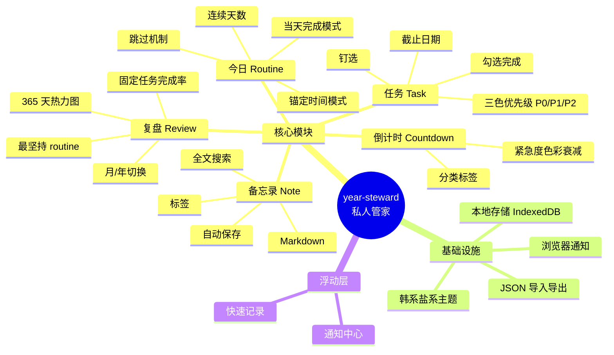
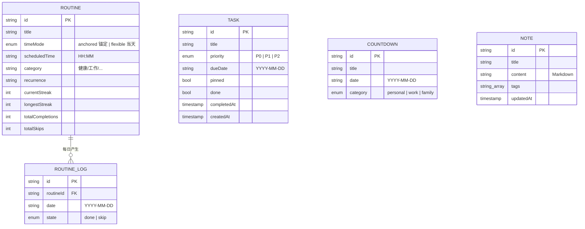

# year-steward 产品需求文档（PRD）

**版本**：v0.3 · 2026-10-14
**作者**：年轮管家产品组
**状态**：M1/M2 已落地，进入 UI 打磨阶段

---

## 1. 产品概述

### 1.1 一句话定位

**year-steward 是一位「私人品质」的数字管家**——帮你抓住一闪而过的念头、对抗日常的拖延、在重要日子温柔地戳你一下、并在年末让你看见自己走过的路。

### 1.2 产品愿景

让"想一出是一出"和"拖延"不再是自我管理的敌人，而是被温柔接住的人性。通过**主动感知 + 极简记录 + 美学复盘**，让个人时间管理回归"人"本身。

### 1.3 用户群画像

**主用户（你）**：
- 30 岁左右都市白领 / 自由职业 / 设计产品创意从业者
- 注重生活美学，喜欢手帐/盐系审美
- 想自律但总被拖延打败
- 痛点：想一出是一出、错过重要日子、需要复盘
- 设备：Mac 电脑 + iPhone 手机

**同好用户（v0.3+ 拓展）**：
- 与主用户类似画像的"想管好自己但做不到"的人
- 不愿被 SaaS 绑架、喜欢开源/可自部署
- 期待一个"美且有用"的工具

### 1.4 核心价值主张

| 价值 | 落地形式 |
|---|---|
| **5 秒随手记** | 全局 ⌘+N 唤起，自然语言一行回车 |
| **今日不漏** | 浏览器通知 + 今日焦点页 |
| **拖延被接住** | 剩 2h 温柔提醒，不催只问 |
| **年末有迹** | 月/年复盘 + 365 热力图 + 分享卡 |
| **美感即正义** | 韩系盐系手帐风，每条记录有美感 |

---

## 2. 用户场景与痛点

### 2.1 痛点 1：想一出是一出

**场景**：
> 跟同事聊完下周五吃饭，回家路上想起"该给妈妈买生日礼物"——5 分钟后完全忘了。

**现状**：
- 打开 todo app 太重，跳过
- 写在备忘录里，但分散在各处
- 想记的事没记，过几天又想起来再急急忙忙

**产品解决**：
- 全局快捷键 ⌘+N 唤起
- 自然语言识别：「周五和老张吃饭」→ 自动建倒计时
- 5 秒记下不打断，分类自动

### 2.2 痛点 2：拖延 + 被插单

**场景**：
> 当天列了 5 件事，做到第 2 件时被领导叫去开会，剩下 3 件推到明天，明天又继续拖。

**现状**：
- 列表越积越长，越看越焦虑
- 缺乏"今日焦点"，什么都想做

**产品解决**：
- 启动页只显示"今日 3 件"
- 浏览器原生通知 9:00 推送
- 完成一条有鼓励仪式感

### 2.3 痛点 3：错过重要日子

**场景**：
> 妈妈的生日、结婚周年、合同续签——总是临时想起、手忙脚乱。

**现状**：
- 系统日历太正式、不够明显
- 没有"重要日子"的概念

**产品解决**：
- 倒计时卡片置顶，颜色随天数变化
- < 7 天变红、< 30 天变橙
- 提前 1 周 / 1 天 双重提醒

### 2.4 痛点 4：缺乏复盘

**场景**：
> 年底想"今年我都做了啥"，发现什么都想不起来。

**现状**：
- 完成的 todo 散落各处，没汇总
- 习惯坚持没记录，三天打鱼两天晒网

**产品解决**：
- 月/年复盘视图（自动生成）
- 365 天热力图（GitHub 风）
- 年度复盘分享卡（手帐风，可发朋友圈）

---

## 3. 需求清单

> 本节是**已定稿**的需求（P0/P1/P2/不做）。
> 后续新收集、还没定稿的需求统一登记在 [`BACKLOG.md`](./BACKLOG.md) 需求池，排期时再从池子里捞进本节。

### 3.1 P0 必做（v0.1 出活）

| 编号 | 模块 | 关键功能 | 验收 |
|---|---|---|---|
| P0-01 | 智能快速记录 | ⌘+N 全局唤起，自然语言识别 | 输入"周五和老张吃饭"自动建倒计时 |
| P0-02 | 任务 | CRUD + 截止日期 + 三色优先级 + 勾选完成 | 列表按优先级+截止自动排序 |
| P0-03 | 重要倒计时 | 倒计时卡片 + 颜色随天数变化 | <7 天红、<30 天橙、其他蓝 |
| P0-04 | 备忘录 | Markdown + 标签 + 全文搜索 | 支持 checkbox、引用、代码块 |
| P0-05 | 本地存储 | IndexedDB（Dexie） | 离线可用，关浏览器数据不丢 |
| P0-06 | Gist 同步 | 一键 push/pull + 自动同步 | Token 存本地，零服务器依赖 |
| P0-07 | 浏览器通知 | Service Worker 提前 1h 提醒 | 申请权限后正常工作 |
| P0-08 | 韩系盐系 UI | 莫兰迪配色 + 圆角 14-18px + 无阴影 | 4 套主题（奶白/奶咖/暗色/樱粉） |

### 3.2 P1 推荐（v0.2）

| 编号 | 模块 | 关键功能 |
|---|---|---|
| P1-01 | 今日焦点 | 启动页只显示"今天 3 件 + 3 倒计时" |
| P1-02 | 月/年复盘 | 完成率 + 拖延数 + 重要事项回顾 |
| P1-03 | 365 热力图 | GitHub 风，点越深=当天事越多 |
| P1-04 | PWA 装桌面 | iPhone 桌面图标 + 离线 shell |
| P1-05 | JSON 导入导出 | 永久备份 + 跨设备迁移 |
| P1-06 | Onboarding 引导 | 性格自测 3 题驱动个性化 |

### 3.3 P2 选做（v0.3+）

| 编号 | 模块 | 关键功能 |
|---|---|---|
| P2-01 | 习惯追踪 | 每日打卡 + 连续天数 + 统计 |
| P2-02 | 周回顾推送 | 每周日自动生成回顾 |
| P2-03 | 标签系统 | 多维分类（#工作 #生活 #健康） |
| P2-04 | AI 智能建议 | 基于完成习惯推荐时间盒 |
| P2-05 | iCloud Calendar 同步 | 双向往返 |
| P2-06 | 复盘分享卡导出 | PNG 下载 + 二维码 |
| P2-07 | GitHub OAuth 登录 | 一键登录免输 Token |

### 3.4 不做（明确排除）

| ❌ | 内容 | 原因 |
|---|---|---|
| ❌ | 番茄钟/时间盒 | 够用就停手，避免功能堆砌 |
| ❌ | 多用户系统 | 私人助理，不是团队工具 |
| ❌ | 第三方账号登录（v0.1） | 一个 GitHub Token 走天下 |
| ❌ | 复杂权限/角色 | 个人独享 |
| ❌ | 数据上云（v0.1） | 本地 + Gist 足够 |
| ❌ | 推送广告/营销 | 私人品质，不卖用户 |

---

## 4. 产品结构图与信息架构图

> 三张图自上而下展示 year-steward 的产品形态：**产品结构图**（顶层模块）→ **功能结构图**（功能树）→ **信息结构图**（数据实体与关系）。

### 4.1 产品结构图

year-steward 的整体模块层级——「一个私人管家」由哪些顶层模块组成。



### 4.2 功能结构图

每个核心模块展开为哪些具体功能——按页面维度拆解。

```mermaid
graph TD
  ROOT[year-steward]:::root
  ROOT --> M1[今日 Routine]
  ROOT --> M2[任务 Task]
  ROOT --> M3[倒计时 Countdown]
  ROOT --> M4[备忘录 Note]
  ROOT --> M5[复盘 Review]
  ROOT --> M6[基础设施]

  M1 --> M1a[CRUD]
  M1 --> M1b[⏰ 锚定时间模式]
  M1 --> M1c[☁️ 当天完成模式]
  M1 --> M1d[连续天数与跳过]

  M2 --> M2a[CRUD]
  M2 --> M2b[P0/P1/P2 优先级]
  M2 --> M2c[截止日期 / 钉选]
  M2 --> M2d[勾选完成]

  M3 --> M3a[CRUD]
  M3 --> M3b[紧急度色彩衰减]
  M3 --> M3c[个人/工作/家人 分类]

  M4 --> M4a[CRUD]
  M4 --> M4b[Markdown 编辑]
  M4 --> M4c[标签]
  M4 --> M4d[全文搜索]

  M5 --> M5a[月/年切换]
  M5 --> M5b[固定任务完成率]
  M5 --> M5c[延期数]
  M5 --> M5d[365 天热力图]
  M5 --> M5e[最坚持 routine]

  M6 --> M6a[IndexedDB 本地存储]
  M6 --> M6b[韩系盐系主题]
  M6 --> M6c[浏览器通知]
  M6 --> M6d[JSON 导入导出]

  classDef root fill:#F1DBDB,stroke:#938C83,color:#2c2c2c,stroke-width:2px
```



### 4.3 信息结构图（数据实体与关系）

year-steward 的核心数据实体与它们之间的关系——是 4.2 每个功能背后实际写入/读出的存储结构。



**关系与状态说明**：

- `ROUTINE` 与 `ROUTINE_LOG` 是 **1 对多**关系：每个 routine 每天最多一条 log（`done` / `skip`）
- `TASK` 独立，三种状态：待办 / 已完成（`done=true`） / 已延期（`dueDate` 已过且 `done=false`）
- `COUNTDOWN` 独立，紧急度由 `daysUntil(date)` 实时计算：<7 天红、<30 天橙、其他蓝灰
- `NOTE` 独立，按 `updatedAt` 倒序
- 所有数据存于 IndexedDB（Dexie），**不上传服务器**

> 解读顺序：先看 4.1（产品长什么样）→ 再看 4.2（每个模块做什么）→ 最后看 4.3（背后存什么）。

---

## 5. 信息架构

### 5.1 页面地图

```
year-steward
├── 首次访问
│   ├── ① 欢迎页 /welcome
│   ├── ② 性格自测（3 题）
│   └── ③ Gist 同步（可选）
│
├── 日常使用
│   ├── ④ Dashboard /         （今日 3 件 + 倒计时 + 热力图）
│   ├── ⑤ 任务 /tasks
│   ├── ⑥ 倒计时 /countdowns
│   ├── ⑦ 备忘录 /notes
│   ├── ⑧ 复盘 /review       （月/年切换）
│   ├── ⑨ 分享 /share/:year
│   └── ⑩ 设置 /settings
│
└── 浮动层
    ├── ⌘+N 快速记录
    └── 浏览器原生通知
```

### 5.2 核心导航

- **Sidebar（左）**：图标导航 6 个页面
- **主区**：根据当前页面切换
- **顶栏**：当前日期 + 主题切换 + 设置入口
- **底部（移动端）**：5 个 tab 切换

---

## 6. 数据模型

### 6.1 任务 Task

```ts
{
  id: string              // uuid
  title: string           // 必填
  description?: string    // Markdown
  priority: 'low' | 'med' | 'high'  // 三色优先级
  dueDate?: number        // timestamp
  startDate?: number      // timestamp
  completedAt?: number    // 完成时间
  archivedAt?: number     // 归档时间
  tags: string[]
  group?: string          // 工作/生活/健康
  linkedFrom?: string[]   // 关联任务
  metadata?: object       // 自由扩展
  createdAt: number
  updatedAt: number
  source: 'manual' | 'nlp' | 'gist'
}
```

### 6.2 倒计时 Countdown

```ts
{
  id: string
  title: string
  date: number            // 目标日期
  type: 'once' | 'yearly' | 'monthly'
  category?: string       // 生日/纪念日/deadline
  notes?: string
  notifyBefore: number[]  // [7, 1] 提前 7 天、1 天提醒
  createdAt: number
}
```

### 6.3 备忘录 Note

```ts
{
  id: string
  title: string
  content: string         // Markdown
  tags: string[]
  pinned: boolean
  createdAt: number
  updatedAt: number
  archivedAt?: number
}
```

### 6.4 用户偏好 Preference

```ts
{
  theme: 'cream' | 'mocha' | 'dark' | 'sakura'
  onboardingDone: boolean
  personality: 'never' | 'sometimes' | 'often' | 'always'
  notificationsEnabled: boolean
  smartNlpEnabled: boolean
  gistToken?: string
  gistId?: string
  lastSyncAt?: number
}
```

### 6.5 复盘统计 ReviewSnapshot

```ts
{
  id: string
  period: '2026-10' | '2026'   // 月份/年份
  type: 'month' | 'year'
  completedTasks: number
  totalTasks: number
  avgDelayDays: number
  habitDays: number
  notesCreated: number
  heatmap: number[]            // 365 长度，每天 0-4
  generatedAt: number
}
```

---

## 7. 关键交互设计

### 7.1 智能快速记录（自然语言）

**触发**：⌘+N（任意页面）

**输入**：
```
> 周五和老张吃饭
> 下周二交 Q3 报告
> 买猫粮（重要）
> 记一下：复盘会议提到 AI 趋势
```

**识别规则**：
- 含「周X/明天/下周/月X」+ 动词 → 任务（含日期）
- 含「X月X日/生日/纪念」+ 名字 → 倒计时
- 含「记一下/备忘/idea」+ 内容 → 备忘录
- 默认：识别不出则弹选择

**输出**：
- 回车即保存
- 右上角 toast「✓ 已识别为任务 · 10/17」

### 7.2 今日焦点推送

**触发**：每天 09:00（本地时区）

**通知内容**：
```
今天 3 件：
1. 升职答辩准备（紧急）
2. 回邮件 × 3
3. 锻炼 30 分钟

最近：妈妈生日 23 天
```

**用户可关闭**：设置中可关

### 7.3 拖延温柔提醒

**触发**：任务剩 2h（截止前 2 小时）

**弹窗**：
```
⏰ 还有 2 小时
"升职答辩准备" 截止 14:00
要现在做吗？
[ 现在做 ] [ 稍后 ] [ 今天不做了 ]
```

**不催**：选择"今天不做了"不惩罚，仅移到"已延期"

### 7.4 完成仪式感

**触发**：勾选任务完成

**效果**：
- 勾选动画（柔顺 200ms）
- 1.2 秒气泡提示：「✓ 又搞定一件」
- 任务划线变灰，但保留可见

### 7.5 复盘分享卡

**触发**：进入 `/share/2026` 页面

**生成**：
- 自动汇总本年度数据
- 渲染为手帐风图片
- 「下载 PNG」按钮

**卡片内容**：
- 标题：2026
- 数字：完成 347、重要 23、习惯 89
- 热力图：365 格子
- 落款：「— 我的年度足迹」

---

## 8. UI 设计规范

### 8.1 调色板（韩系盐系）

| 用途 | 颜色 | 色值 |
|---|---|---|
| 背景 | 奶白 | `#faf8f5` |
| 卡片 | 纯白 | `#ffffff` |
| 主色 | 雾霾薄荷 | `#b8d4cc` |
| 辅助 | 雾霾紫 | `#c8c4d6` |
| 强调 | 莫兰迪橘 | `#f0c8b0` |
| 警示 | 莫兰迪红 | `#e8b8b0` |
| 文字 | 深灰 | `#2c2c2c` |
| 弱文字 | 灰褐 | `#8a857c` |
| 边框 | 浅米 | `#e8e3da` |

### 8.2 排版原则

1. 字号克制：13-15px 为主，标题 16-18px
2. 颜色：背景永远浅，文字不用纯黑
3. 留白：元素之间最少 12px，卡片内 padding 16-20px
4. 圆角：卡片 14-18px，按钮 10-12px，输入框 12px
5. 不加阴影：1px 浅色边框代替阴影分隔
6. 字体：思源黑体 / Pretendard / Noto Sans CJK

### 8.3 组件库

- 自研极简组件，参考 shadcn/ui 但不堆复杂依赖
- 5 个核心组件：Card、Badge、Button、Input、Modal
- 全部支持暗色 + 4 套主题切换

---

## 9. 技术架构

### 9.1 技术栈

```
Vite 5 + React 19 + TypeScript
Tailwind CSS v4
shadcn/ui（精简）
Zustand（状态）
Dexie.js（IndexedDB）
day.js（时间）
Service Worker + Notification API（提醒）
GitHub Actions（自动部署 + 定时）
```

### 9.2 数据存储

| 层 | 用途 |
|---|---|
| IndexedDB（Dexie） | 主存储，所有任务/倒计时/备忘录 |
| GitHub Gist | 多设备同步，零服务器依赖 |
| localStorage | 用户偏好、Token |
| Service Worker Cache | PWA 离线 shell |

### 9.3 部署方案

- **托管**：GitHub Pages（`username.github.io/year-steward`）
- **CI/CD**：GitHub Actions 自动构建部署
- **域名**：先白嫖 `github.io`，未来可换自定义
- **HTTPS**：GitHub 自动配

### 9.4 模块化分层

```
数据层（Dexie tables）  ← 唯一改存储的地方
业务层（priority/sort）  ← 计算逻辑
UI 层（pages/components）← 纯渲染
提醒层（notify）         ← 独立可换
```

---

## 10. 非功能需求

### 10.1 性能

- 首屏加载 < 2s（GitHub Pages + CDN）
- 单页操作 < 100ms
- 1000 条数据流畅滚动

### 10.2 隐私

- 默认本地存储，不上传任何服务器
- Gist Token 仅存 localStorage
- 不引入任何追踪脚本
- 开源可审计

### 10.3 离线

- PWA 配置 Service Worker
- 首次访问后离线可用
- 同步在网络恢复时自动重试

### 10.4 兼容性

- 浏览器：Chrome / Safari / Edge 最新两个版本
- iOS：Safari 16.4+（支持 PWA 通知）
- 屏幕：桌面 1280+ / 移动 375+

---

## 11. 里程碑与验收

### 11.1 里程碑划分

| # | 里程碑 | 内容 | 时间 | 验收 |
|---|---|---|---|---|
| M1 | 脚手架 | Vite + React + TS + Tailwind + GitHub Pages 自动部署 | 30 min | 部署成功，URL 可访问 |
| M2 | 数据层 | Dexie + Zustand + 任务/倒计时/备忘录 CRUD | 1 h | 增删改查通过 |
| M3 | UI 主页面 | 4 核心页面 + 韩系盐系主题 | 2 h | 全部页面渲染正常 |
| M4 | Gist 同步 | push/pull + 冲突解决 | 1 h | Mac 改 iPhone 可见 |
| M5 | 复盘 + PWA | 月/年复盘 + 热力图 + PWA | 1.5 h | 可装桌面 + 复盘可看 |

**总计**：约 6 小时（1 个工作日内可完成）

### 11.2 验收标准（M1-M5 全完成后）

- [ ] URL 可访问，HTTPS 正常
- [ ] 创建任务/倒计时/备忘录，加载页面可见
- [ ] 浏览器通知权限申请成功
- [ ] Gist 同步双向正常
- [ ] 月/年复盘可切换
- [ ] 365 热力图正常渲染
- [ ] iPhone Safari 可装到桌面
- [ ] 4 套主题可切换
- [ ] 数据可导出/导入 JSON
- [ ] README 完整，使用说明清晰

---

## 12. 风险与对策

| 风险 | 影响 | 对策 |
|---|---|---|
| GitHub Pages 静态限制 | 提醒只能本地 | M1 用浏览器原生通知兜底 |
| iOS Safari 通知权限 | 部分用户拿不到提醒 | 设置页明确告知 + PWA 引导 |
| Gist API 限流 | 频繁同步会失败 | 5 分钟防抖 + 失败重试 |
| 1 人维护精力 | 功能堆砌失控 | 严格 P0/P1/P2 分级 |
| 数据丢失 | 用户最痛 | JSON 导出 + Gist 双备份 |

---

## 13. 后续规划（v0.3+）

1. **云端账号**：GitHub OAuth 登录，免输 Token
2. **习惯追踪**：P2-01，P0 完成后第一优先级
3. **AI 智能**：P2-04，基于完成习惯推荐时间盒
4. **第三方同步**：iCloud Calendar / Google Calendar
5. **公开 API**：让第三方写插件
6. **移动 App**：PWA 体验不够时考虑 React Native

---

**已落地里程碑**：M1 ✅ 脚手架 + 部署 ｜ M2 ✅ 数据层 + CRUD + 真实复盘 ｜ 下一站 M3 UI 主页面打磨
