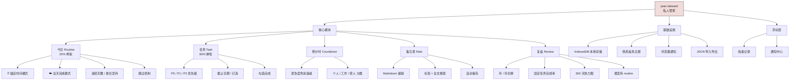
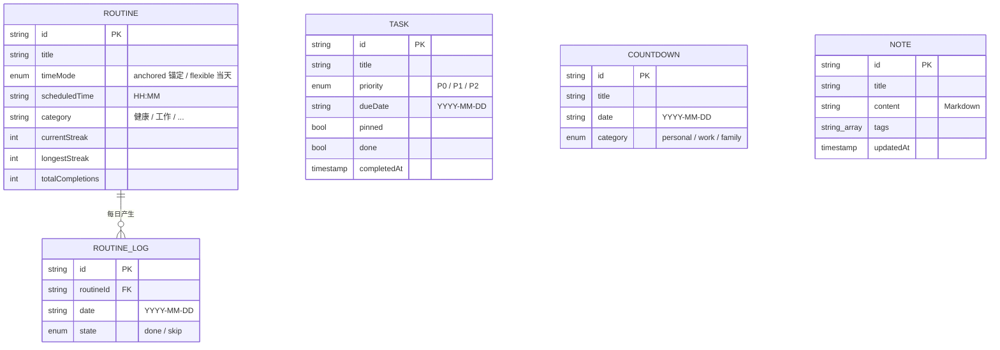

<p align="center">
  
</p>

<h1 align="center">year-steward · 私人管家</h1>

<p align="center">
  <strong>你随手记，它按时戳你一下。</strong><br>
  一个韩系盐系的年度管家 Web App：固定任务、弹性任务、倒计时、备忘录与复盘。
</p>

<p align="center">
  <a href="https://z15808175209-ai.github.io/year-steward/"><strong>🚀 打开项目入口（在线体验）</strong></a>
  ・
  <a href="#产品结构图">结构图</a>
  ・
  <a href="#核心能力">功能</a>
  ・
  <a href="#本地开发">本地运行</a>
  ・
  <a href="#路线图">路线图</a>
  ・
  <a href="https://github.com/z15808175209-ai/year-steward/issues">反馈问题</a>
</p>

<p align="center">
  <a href="https://github.com/z15808175209-ai/year-steward/actions/workflows/deploy.yml"></a>
  
  
  
  
  <a href="./LICENSE"></a>
</p>

<p align="center"><sub>所有数据只存在你的浏览器里 · 无账号 · 无登录 · 无追踪 · 不上云</sub></p>

---

## 这是什么

一个温柔的「主动管家」。你随手记，它帮你分门别类、定优先级、按时戳你一下；你拖延了，它不催你、只是提醒；你做完了，它会记下，让你复盘时看见。

设计上遵循**二八定律**：**20% 的固定任务（Routine）打骨架，80% 的弹性任务（Task）填内容**。先把那 20% 做到极致，剩下的随性一点也没关系。

**韩系盐系风格** · Mac 桌面优先 · 纯本地数据 · 开源可自部署

---

## 目录

- [产品结构图](#产品结构图)
- [核心能力](#核心能力)
- [信息结构（数据模型）](#信息结构数据模型)
- [技术栈](#技术栈)
- [项目结构](#项目结构)
- [本地开发](#本地开发)
- [部署](#部署)
- [数据隐私](#数据隐私)
- [设计规范](#设计规范)
- [路线图](#路线图)

---

## 产品结构图



> 完整的三视图（产品结构图 / 功能结构图 / 信息结构图）见 [`PRD.md`](./PRD.md) 第 4 节。

---

## 核心能力

| 模块 | 说明 | 状态 |
|---|---|---|
| **Routine 固定任务** | 双模式：⏰ 锚定时间（到点提醒 + 按时率）・☁️ 当天完成（只看完成率，不被时间绑死）<br/>连续天数 / 最长坚持 / 跳过机制 | ✅ |
| **Task 弹性任务** | 三色优先级（P0/P1/P2）+ 截止日期 + 钉选 + 完成勾选 + 编辑删除 | ✅ |
| **Countdown 倒计时** | 重要日期 + 颜色随紧急度衰减（<7 天红 / <30 天橙 / 其他蓝灰） | ✅ |
| **Notes 备忘录** | Markdown + 标签 + 全文搜索 + 自动保存 | ✅ |
| **Review 复盘** | 月/年视图 + Routine 完成率置顶 + 延期数 + 365 天热力图 + 最坚持 routine | ✅ |
| **加载与空白态** | 弱网骨架屏 + 每个页面的醒目「新建第一个…」入口 | ✅ |

每个页面在数据为空时都会显示带**大号 CTA 按钮**的空白态，不会出现「不知道从哪开始」的空白屏。

---

## 信息结构（数据模型）



- `ROUTINE` ↔ `ROUTINE_LOG`：**1 对多**，每个 routine 每天最多一条日志（`done` / `skip`）
- `TASK` 三种状态：待办 / 已完成 / 已延期（`dueDate` 已过且未完成）
- `COUNTDOWN` 的紧急度由 `daysUntil(date)` 实时计算，不落库
- 全部数据存于 IndexedDB（Dexie），**不上传服务器**

---

## 技术栈

```
Vite 5 + React 18 + TypeScript
Tailwind CSS 3（自定义韩系盐系色板）
Dexie.js 4 + dexie-react-hooks（IndexedDB 本地数据库）
Framer Motion（动效）
lucide-react（图标）
GitHub Actions + Pages（自动部署）
```

数据分层：`db.ts`（表结构）→ `repo.ts`（写操作）→ `lib/stats.ts`（聚合统计）→ 页面 `useLiveQuery` 实时渲染。

---

## 项目结构

```
year-steward/
├── src/
│   ├── db.ts              # Dexie 表结构 + seed
│   ├── repo.ts            # 所有写操作（CRUD）
│   ├── types.ts           # 数据模型类型
│   ├── App.tsx            # 路由 + 全局初始化
│   ├── pages/
│   │   ├── Dashboard.tsx  # 今日总览
│   │   ├── Routines.tsx   # 固定任务
│   │   ├── Tasks.tsx      # 弹性任务
│   │   ├── Countdowns.tsx # 倒计时
│   │   ├── Notes.tsx      # 备忘录
│   │   └── Review.tsx     # 复盘
│   ├── components/        # Modal / EmptyState / Skeleton / 表单
│   └── lib/               # date.ts / stats.ts
├── public/icon.svg        # 应用图标
└── .github/workflows/deploy.yml
```

---

## 本地开发

```bash
npm install
npm run dev
# → http://localhost:5173/
```

构建：

```bash
npm run build
npm run preview
```

---

## 部署

推送到 `main` 分支会自动触发 GitHub Actions 构建并部署到 GitHub Pages。

| 入口 | 地址 |
|---|---|
| 🌐 **在线体验** | https://z15808175209-ai.github.io/year-steward/ |
| 💻 源码仓库 | https://github.com/z15808175209-ai/year-steward |

---

## 数据隐私

- 所有数据存在你的浏览器 **IndexedDB** 本地，**不上传任何服务器**
- 无账号、无登录、无追踪、无第三方统计
- 换设备需手动导出/导入（后续版本会加同步能力）
- 想清空：`DevTools → Application → IndexedDB` 删除 `YearStewardDB`，或在 console 执行 `await indexedDB.deleteDatabase('YearStewardDB')`

---

## 设计规范

| 色号 | 用途 |
|---|---|
| `#FCF5EC` | 奶白 · 页面底色 |
| `#F1DBDB` | 樱粉 · 主色调 |
| `#D4D1C6` | 米灰 · 边框 / 分隔线 |
| `#938C83` | 深灰 · 文字 |
| `#D88A8A` | 紧急（派生） |
| `#A8C8B8` | 完成（派生） |

圆角 `14px` · 无阴影 · 大量留白 · 莫兰迪低饱和

---

## 路线图

- **M1 ✅** 5 个核心模块 + IndexedDB 本地存储 + GitHub Pages 自动部署
- **M2 ✅** 数据层（`repo`）+ 全部模块 CRUD + 真实复盘统计（替换 mock）
- **M2.5 ✅** 弱网骨架屏 + 空白态大 CTA 入口 + 应用图标 / favicon
- **M3（下一步）** 主页面 UI 打磨 + 韩系盐系主题统一 + 快速记录浮层
- **后续** 浏览器通知提醒 · 复盘 PNG 导出分享 · 移动端 PWA · JSON 导入导出 · AI 理性助理

---

## License

[MIT](./LICENSE)
